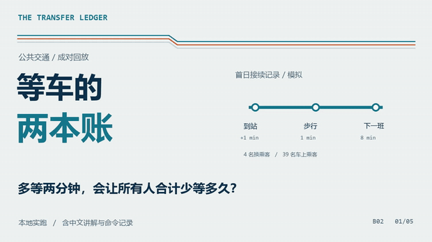

# 等车的两本账

多等两分钟，会让所有人合计少等多久？

[](demo/demo.mp4)
[播放或下载 52 秒中文演示](demo/demo.mp4) · [查看真实终端记录](demo/transcript.txt)

0:00 研究问题 · 0:06 实际输入 · 0:17 运行与结果 · 0:28 追问与反例 · 0:40 复演与适用边界

## 自己跑一次

在仓库根目录运行以下命令。需要 Python 3.10 或更新版本，演示仅依赖标准库。每一步可独立执行。

```shell
python demo/run.py input
python demo/run.py run
python demo/run.py challenge
```

演示临时复制并运行 `附件/复核实验/forecast.py`。每个运营日的无等候策略与两分钟上限策略使用同一组输入，汇总换乘节省和车上新增延误。 如果要直接调用研究脚本，可运行以下命令。

```shell
python -X utf8 "附件/复核实验/forecast.py"
```

原研究脚本会用本次输出刷新同目录的结果表；上方演示入口在临时目录执行相同脚本，便于连续对照。

## 已测结果与边界

准确预测的净节省为 +2590 人分钟。误差标准差为 2 分钟时中位数为 +517，人为加入 −2 分钟预测偏差和 1 分钟随机误差时为 −663，10%／90% 分位数为 −1070／−278。

两类乘客每分钟等权。模型使用模拟运营日，并以独立预测误差回放；真实线路需要实测预测偏差。

[90 天输入](附件/复核实验/new_service_days.csv) · [逐次账本](附件/复核实验/paired_repeats.csv) · [研究报告](研究报告.md)

## 数据与演示素材

运营日、车上人数、接续时刻和预测扰动均为本仓原创模拟，200 次回放使用固定种子。 视频中的命令已在本地 Python 环境实际执行；动画按输出分步显示，中文配音由本机离线语音合成。项目演示采用仓库脚本。

[研究报告 PDF](研究报告.pdf) · [一页说明](一页说明.pdf) · [工作流步骤](附件/Mira%20工作流.md) · [研究海报](海报.pdf) · [答辩 PPT](答辩.pptx)


[下载独立工作流附件 ZIP](B02-transfer-ledger-附件包.zip)


[下载 80 × 200 cm 印刷海报 PDF](海报.pdf) · [下载 300 dpi 海报 JPG](海报.jpg)
