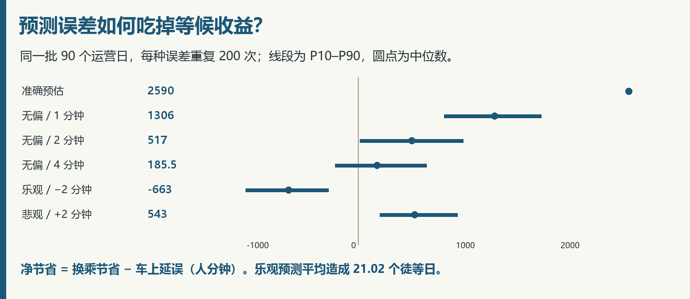

# 等车的两本账

## 调度席上的问题

当接驳车晚到两分钟，连接车要不要等？换乘客错过本班需要等待下一趟，已在连接车上的乘客则承担延误。只看接续率会遗失后者，只看平均到站时间又会遗失哪两班车在同一天相遇。我们用一份逐日配对账本让这两类成本都能被追问。

本次研究比较同一组服务日在四种等待上限下的回放。研究问题是，准点发车、限等一至三分钟会如何改变同一批乘客的接续率和总人分钟；固定策略在不同配对结构下的效果能否外推。

## 输入与权限

`service_days.csv` 有三个虚构换乘情景、每个 12 个服务日，共 36 行。每条记录包括接驳到达、连接车原发时刻（均以计划连接时刻为零点，负数表示提前）、步行时间、换乘人数、车上人数、后续班距和取消标志。同向延误与反向错位拥有相同的两套时刻边际分布，但改变了当天两班的配对。晚班情景将班距设为 35 分钟并加入一次取消。所有数字和站名为原创模拟，未使用乘客轨迹或运输企业记录。允许将本包随作品公开展示、复制和复算。

## 计算协议

令 g = 接驳到达 + 步行时长 − 连接原发。若连接班次正常且 0 < g ≤ 等待上限，则实际等待 g 分钟；否则保持原时刻。恰好踩点视为赶上。错过或取消后搭乘原发时刻加后续班距的下一班。模型假设所有样本都能搭上下一班，调度员可以准确预测所需等候时间。

每位换乘客的站台等待从步行结束算起，车上乘客延误按该班等待分钟乘车上人数计算。被接住的人也计入分母。总成本为两类人分钟之和，等权仅用于演示。

| 环节 | 必须交付的对象 | 验收条件 |
| --- | --- | --- |
| 配对 | 一行对应一个站点服务日 | 唯一键不能重复；人数、步行时长、班距非负；取消标志合法 |
| 回放 | 每日缺口、等待、接住人数与两类成本 | 任一实际等待不超过该策略上限；取消日接住 0 人 |
| 汇总 | 每站 4 个策略行与 12 个原日证据行 | 两类成本加总正确，接住人数随上限不降，分母对四策相同 |
| 复核 | 手算记录与权重敏感性 | 5 位换乘客、9 位车上乘客的样例，准点成本 65，等 2 分钟成本 18 |

整体通过条件是上述断言全部通过，能任取一站一日回到原始数字，且对至少一个方案同时报出获益者和成本承担者。

## 两分钟的实测账本

| 情景 | 准点接住 / 88 人 | 限等 2 分钟接住 / 88 人 | 减少换乘等待（人分钟） | 新增车上延误（人分钟） | 净节省（人分钟） |
| --- | ---: | ---: | ---: | ---: | ---: |
| 同向延误 | 25 | 79 | 731 | 140 | 591 |
| 反向错位 | 32 | 43 | 154 | 10 | 144 |
| 晚班接续 | 24 | 52 | 937 | 122 | 815 |

同向延误和反向错位的连接车原发时刻分布完全相同。将两站各自两个时刻列分别打散，会抹去上表两种方案之间的关键区别。在晚班样本上，限等 2 分钟仍有 36 人未赶上本班，其中含取消日乘客。完整 0、1、2、3 分钟结果保存在 `replay.json`。

## 反问：车上延误如果更贵？

将车上人分钟乘以权重 w，换乘人分钟保持权重 1。同向延误的等权净收益 591；当 w 超过 731/140 ≈ 5.22，这一方案就比准点发车更贵。另两站的临界权重约为 15.40 和 7.68。该敏感性只反映当前样本，不能代替乘客调查，也没有计入下游串接、道路拥挤、预测误差或载客容量。若用于现场决策，应先取得真实的车辆配对、断班、客流与后继班次数据并验证运行假设。

## 复现与演示

本地核验使用 Windows x64、Intel x64 CPU、CPython 3.11.9。分析仅依赖 Python 标准库，单进程运行，无需 GPU 或联网。解压附件包，在含 `analyze.py` 的目录打开终端。以下命令均以该目录为工作目录。

```powershell
python make_fixture.py
python analyze.py service_days.csv
python verify.py
python stress.py
```

`verify.py` 写出逐日和汇总结果，`stress.py` 写出权重临界值及其分子与分母。Mira 桌面端使用附件里的四轮调度推演。本文数据来自本地确定性回放，桌面端对话和分享链接须在实际运行后生成。

## 复核实验 v2 · 当司机看到的到达时间会错

原实验 v1 的逐日回放和海报使用准确到达时间。本次使用独立种子 202907 新建三组线路（高频、普通、晚班），每组 30 个运营日。后继班距为 8、16、30 分钟，车上人数按线路强度生成，晚班含一个取消日。原有 36 个运营日均未进入本次样本。

以真实接续缺口 g 与预测缺口 ĝ 区分“下达等候指令”与“乘客实际赶到”。仅在正常运营且 0 < ĝ ≤ 2 时下达指令。乘客赶到便离站，最长等 2 分钟；实际缺口大于 2 分钟会徒等，车上延误照计。基准为原时刻发车。对每组策略，用相同标准正态抽样构造不同强度的误差，加偏差后四舍五入至整分钟。每种情景在同一 90 日账本上作 200 次误差回放。报告的范围描述这一设定内的噪声分布。

| 预测误差（偏差, 标准差，分钟） | 净节省 P10 | 中位数 | P90 | 平均徒等日 |
| --- | ---: | ---: | ---: | ---: |
| 准确 (0,0) | 2590 | 2590 | 2590 | 0.00 |
| (0,1) | 824 | 1306 | 1751 | 6.28 |
| (0,2) | 20 | 517 | 1007 | 8.36 |
| (0,4) | −216 | 185.5 | 655 | 6.09 |
| 乐观 (−2,1) | −1070 | −663 | −278 | 21.02 |
| 悲观 (+2,1) | 212 | 543 | 951 | 0.14 |

净节省单位为人分钟，正数代表乘客合计少等。一个可手算的错判是实际缺口 4 分钟、预估 2 分钟、车上 7 人，这班车多等两分钟仍接不到该批乘客，净节省 −14 人分钟。报告中的 200 次模拟共享服务日，不能解释为真实公交系统的置信区间。班次连锁延误、天气相关误差和司机临场处置仍未覆盖。

在 `附件/复核实验` 内执行 `python -X utf8 prepare.py`、`python -X utf8 forecast.py`。输入 `new_service_days.csv`，首轮逐日证据在 `day_trace_rep0.csv`，全部分线和合计结果在 `paired_repeats.csv`，摘要为 `results.json`。验收要求包含 90 个服务日、不能接上的班次仍计徒等成本、手算样例得到 −14。全部新输入和脚本可随作品公开演示和复核。


